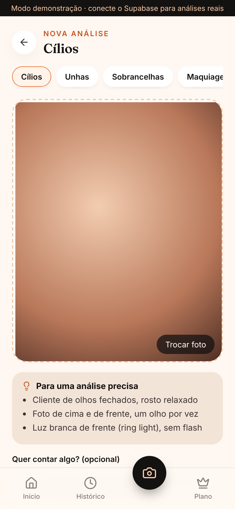

# Foco Beauty · análise de procedimentos de beleza com IA

A profissional tira uma foto do procedimento (cílios, unhas, sobrancelhas, maquiagem, cabelo, micropigmentação, estética…) e recebe em segundos:

- **nota geral** e **nota por critério técnico** do segmento
- **o que está ótimo** (para motivar)
- **plano de evolução**: o que melhorar, por prioridade, com um **passo a passo para a próxima cliente**
- **dica de ouro** e **dica de foto para portfólio**
- **histórico** para acompanhar a evolução

| Início | Captura | Analisando | Resultado | Planos |
|---|---|---|---|---|
|  |  |  |  |  |

## Como é feito

| Parte | Tecnologia |
|---|---|
| App (instalável no celular, PWA) | React + Vite + TypeScript |
| Login, banco, fotos | Supabase (Auth, Postgres com RLS, Storage privado) |
| Análise da foto | Supabase Edge Function `analyze` → Claude (visão) com resposta em JSON estruturado |
| Modelo de negócio (SaaS) | Créditos por perfil (5 grátis), planos Grátis / Pro / Studio |

A chave da IA **nunca vai para o celular**: fica guardada como segredo no Supabase e só a Edge Function usa. Se a análise falhar, o crédito é devolvido automaticamente.

---

## Rodar no computador (modo demonstração)

```bash
npm install
npm run dev
```

Sem o arquivo `.env`, o app abre em **modo demonstração** (análise de exemplo, sem login). Bom para mostrar o visual.

## Colocar no ar com Supabase (passo a passo)

1. **Crie o projeto** em https://supabase.com → New project.
2. **Instale a CLI** e conecte:
   ```bash
   npm i -g supabase
   supabase login
   supabase link --project-ref SEU_PROJECT_REF
   ```
3. **Crie as tabelas, regras e o bucket de fotos:**
   ```bash
   supabase db push
   ```
4. **Guarde a chave da IA** (crie em https://console.anthropic.com):
   ```bash
   supabase secrets set ANTHROPIC_API_KEY=sk-ant-...
   ```
5. **Publique a função de análise:**
   ```bash
   supabase functions deploy analyze
   ```
6. **Configure o app:** copie `.env.example` para `.env` e preencha `VITE_SUPABASE_URL` e `VITE_SUPABASE_ANON_KEY` (Supabase → Project Settings → API).
7. **Publique o site** (gratuito) na Vercel ou Netlify: importe o repositório, comando `npm run build`, pasta `dist`, e cadastre as duas variáveis `VITE_...`.
8. No Supabase → Authentication → URL Configuration, coloque a URL do site publicado em **Site URL**.

## Como as profissionais "baixam" o app

- **Já funciona agora (PWA):** abrir o link no celular →
  - Android/Chrome: aparece o botão **Instalar** no app (ou menu ⋮ → *Instalar app*);
  - iPhone/Safari: botão Compartilhar → **Adicionar à Tela de Início**.
  Fica com ícone, abre em tela cheia e sem barra do navegador.
- **Lojas (Google Play / App Store), próxima etapa:** empacotar este mesmo código com Capacitor (`npx cap add android` / `ios`). Exige conta de desenvolvedor (Google: US$ 25 uma vez; Apple: US$ 99/ano).

## Liberar créditos manualmente (enquanto o pagamento não está integrado)

No Supabase → SQL Editor:
```sql
update profiles set plano = 'pro', creditos = creditos + 60
where id = (select id from auth.users where email = 'cliente@email.com');
```

## Estrutura

```
src/
  screens/        Login, Início, Captura, Resultado, Histórico, Planos
  lib/            supabase, api (upload + análise), segmentos, compressão de imagem
  styles.css      identidade visual (paleta abaixo)
supabase/
  migrations/     tabelas profiles e analyses, créditos, bucket, segurança (RLS)
  functions/analyze/  Edge Function que chama a IA
public/           manifest, service worker e ícones do app
```

## Paleta

| Cor | Hex | Uso |
|---|---|---|
| Ébano | `#141111` | títulos, botões principais, cartões de destaque |
| Cobre (laranja da marca) | `#E8743B` | destaques, notas, botão "Analisar" |
| Cobre escuro | `#C4561F` | texto laranja sobre fundo claro (contraste) |
| Pêssego | `#F7C9A4` | detalhes suaves |
| Nude | `#F3E4D8` | superfícies e ícones |
| Creme | `#FFF8F2` | fundo |

Tipografia: **Fraunces** (títulos, serifada elegante) + **Inter** (textos).

## Próximos passos sugeridos

- Pagamento recorrente (Stripe ou Mercado Pago com Pix) liberando créditos automaticamente
- Comparação **antes × depois** e várias fotos por análise
- Gerar card da análise para postar no Instagram
- Modo **educadora**: avaliar alunas de cursos
- Publicação nas lojas com Capacitor
